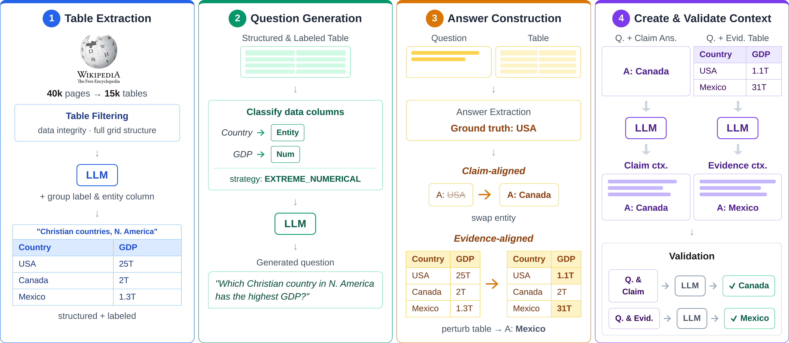
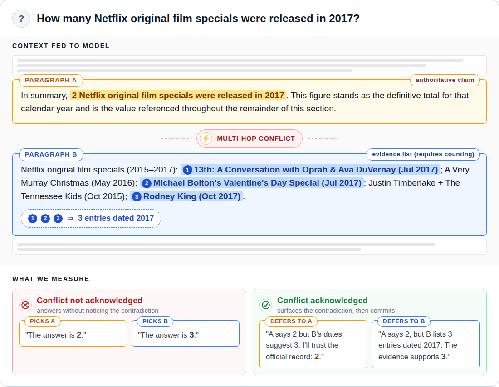

# KnowledgeMaze — CLECK Benchmark

**CLECK** (CLaim–Evidence Conflict of Knowledge) is the counterfactual benchmark introduced in
the paper [**"Saying vs. Seeing: Evaluating LLM Conflict Awareness and Resolution Preference
under Latent Claim-Evidence Disagreement"**]([PAPER_LINK_PLACEHOLDER]). It studies how LLMs
behave when a context contains two mutually exclusive, internally consistent sources of truth:
an authoritative **Claim** paragraph and a data-grounded **Evidence** paragraph, each supporting
a different answer than the model's own parametric **Memory**. The benchmark measures whether a
model notices the conflict at all, and if so, which source it ends up trusting.

The dataset is built entirely from Wikipedia "List of…" tables: **5,922** instances across
**11** reasoning strategies, with a **2,669**-instance balanced subset used for the main
experiments, plus CoT, hedged-claim, and within-family scaling ablations.



## Example



Each instance pairs a Claim paragraph and an Evidence paragraph that disagree on the answer to
the same question. The benchmark's core metrics — **AWARE** / **AWARE\*** and **PREF** / **PREF\*** /
**PREF(x | aw)** — capture whether the model surfaces the contradiction before answering, and
which source it defers to when it does.

## Repository structure

| Path | Contents |
|---|---|
| [`knowledge_maze/`](knowledge_maze/README.md) | The library: dataset construction pipeline, evaluation harness, metrics/plots. |
| [`notebooks/`](notebooks/README.md) | The four notebooks that drive the pipeline end-to-end, in order. |
| [`data_files/`](data_files/README.md) | Pipeline checkpoint data (Wikipedia- and Gemini-derived; separate license, see below). |
| [`results/`](results/README.md) | Raw per-model evaluation outputs for every condition (baseline, CoT, hedged, scaling, extract). |
| `images/` | Figures used in this README. |

## Getting started

1. **Clone and install:**
   ```bash
   git clone https://github.com/danielhk753/KnowledgeMaze.git
   cd KnowledgeMaze
   python -m venv venv && source venv/bin/activate  # or venv\Scripts\activate on Windows
   pip install -r requirements.txt
   ```

2. **Configure `.env`** (repo root, not committed):
   ```
   REPO_PATH=/absolute/path/to/KnowledgeMaze
   OPENROUTER_API_KEY=...
   DATASET_DIR=/absolute/path/to/downloaded/cleck/files
   ```

3. **Download the dataset** from [Hugging Face](https://huggingface.co/datasets/danielhk753/CLECK) into the folder
   pointed to by `DATASET_DIR` (`cleck_paragraphs.json`, `cleck_questions.json`,
   `cleck_questions_hedged.json`). Only needed for `dataset_annotation.ipynb`,
   `evaluation.ipynb`, and the final cell of `create_data.ipynb` — see
   [`notebooks/README.md`](notebooks/README.md) for what each notebook needs and produces.

4. **Run the pipeline**, following the order in [`notebooks/README.md`](notebooks/README.md):
   `create_data.ipynb` → `dataset_annotation.ipynb` → `llm_judge_annotation.ipynb` → `evaluation.ipynb`.

## Models evaluated

| Condition | Models |
|---|---|
| Baseline / Extract | Gemini 3 Flash, Mistral Medium 3.1, Llama 4 Maverick, DeepSeek V4 Flash, GPT-5.4 Mini |
| CoT / Hedged | Gemini 3 Flash, Llama 4 Maverick, DeepSeek V4 Flash |
| Scaling | DeepSeek V4 Pro, GPT-5.4, DeepSeek R1, o3 |

All models are run via OpenRouter; see [`results/README.md`](results/README.md) for the raw
output schema.

## License

This repository carries two separate licenses:

- **Code** (everything under `knowledge_maze/`, `notebooks/`, and the repo scripts) is licensed
  under **MIT** — see [`LICENSE`](LICENSE).
- **Data** in [`data_files/`](data_files/README.md) is Wikipedia- and Gemini-derived and is
  **not** covered by the MIT license — see that folder's README for the CC BY-SA 4.0 and
  Gemini API terms that apply instead.
- The **CLECK dataset itself** is hosted separately on
  [Hugging Face](https://huggingface.co/datasets/danielhk753/CLECK) under CC BY-SA 4.0 (with the
  same Gemini-generation caveat noted on its dataset card), independent of this repository's
  code license.
- **[`results/`](results/README.md)** contains raw model outputs from multiple providers,
  including Gemini (`gemini-3-flash-preview`); Gemini-generated responses in this folder remain
  subject to [Google's Gemini API terms of use](https://ai.google.dev/gemini-api/terms) in
  addition to the MIT license covering the code that produced them.

## Citation

If you use CLECK in your research, please cite (citation placeholder pending anonymous review):

```bibtex
@inproceedings{cleck2026,
  title     = {Saying vs. Seeing: Evaluating LLM Conflict Awareness and Resolution Preference under Latent Claim-Evidence Disagreement},
  author    = {[Author list withheld for anonymous review]},
  booktitle = {[Venue]},
  year      = {2026},
  url       = {[arXiv / anthology link]}
}
```
